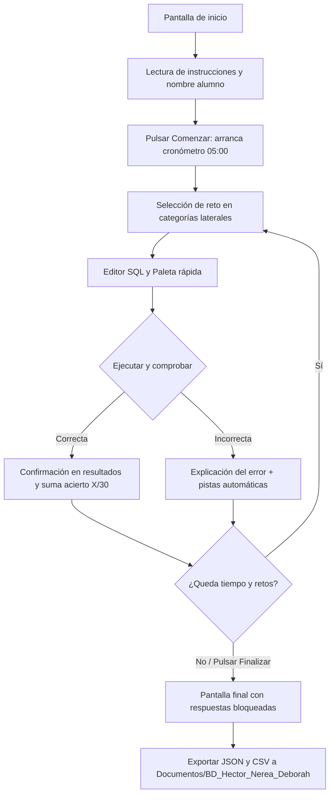

# Memoria del Proyecto — Simulador SQL Sprint Davante

**Módulo:** Gestión de Bases de Datos (ASIR)  
**Actividad:** Práctica Tema 7 — Realización de Consultas  
**Centro:** Instituto Davante  
**Autores:** Hector, Aya y Nerea  

---

## 2. Diseño del simulador

El simulador se ha diseñado como una aplicación de escritorio interactiva orientada a practicar consultas SQL (`SELECT`) de dificultad progresiva sobre la base de datos educativa del centro (`davante_asir.db`). Su objetivo es permitir al alumnado resolver ejercicios reales en entorno seguro, recibir retroalimentación inmediata y generar un informe final con sus resultados.

### 2.1. Requisitos funcionales

La aplicación cumple los siguientes requisitos:

1. **Inicio de sesión:** Pantalla inicial con logotipo del centro, autores, título de la práctica, instrucciones de uso, desglose de categorías, campo editable para el nombre del participante, indicación del tiempo disponible (**5 minutos / 300 segundos**) y botón para comenzar la partida (el reloj permanece detenido hasta iniciar).
2. **Selección de retos:** Carga de un banco de **30 retos** agrupados en 5 categorías temáticas colapsables (6 retos por categoría).
3. **Presentación del reto:** Visualización del identificador y título del reto, categoría temática, enunciado, tabla principal, elementos SQL recomendados, pistas desplegables bajo demanda y editor SQL.
4. **Ejecución de consultas:** Botón de ejecución (y atajo `Ctrl + Enter`) que muestra columnas y filas en tabla con scroll bidireccional, limitando la visualización a un máximo de **50 filas** e informando del total real cuando supera dicho límite.
5. **Evaluación automática:** Comparación del resultado obtenido frente a la consulta canónica de referencia comprobando número y orden de columnas, número de filas, tipos de datos y valores, sin exigir sintaxis idéntica.
6. **Retroalimentación inmediata:** Indicación clara dentro del panel de resultados sobre si la consulta es correcta o incorrecta. En caso de fallo sintáctico o de datos, se explica el motivo concreto y se muestran automáticamente las pistas pedagógicas del reto.
7. **Control del tiempo:** Temporizador global único de **300 segundos (5 minutos)** para toda la sesión, visible de forma permanente en la cabecera y sin reiniciarse al cambiar de reto.
8. **Progreso de la sesión:** Evaluación directa por aciertos sobre el total (`aciertos / 30`, por ejemplo `28/30`), mostrando además estadísticas de intentos realizados, errores cometidos, tiempo empleado y progreso por categoría (`X/6`).
9. **Finalización y bloqueo:** Al agotarse los 300 segundos, avanzar tras el último reto o pulsar el botón **Finalizar**, la sesión se cierra bloqueando cualquier nueva edición o envío de consultas.
10. **Informe final y exportación:** Resumen completo al concluir con calificación final (`X/30`), aciertos, retos no superados, fallos cometidos, tiempo empleado, tiempo restante y exportación en formatos **JSON** y **CSV** en la carpeta del usuario `Documentos\BD_Hector_Nerea_Deborah\`.

### 2.2. Banco de retos

El banco está compuesto por **30 retos obligatorios** divididos progresivamente en 5 niveles temáticos (6 ejercicios en cada nivel):

| Nivel | Categoría Temática | Retos | Contenidos SQL practicados |
| :---: | :--- | :---: | :--- |
| **Nivel 1** | Selección y Proyección | Q01 – Q06 (6) | `SELECT *`, selección de columnas, alias `AS`, `DISTINCT`, concatenación `\|\|` |
| **Nivel 2** | Filtrado con `WHERE` | Q07 – Q12 (6) | `WHERE =`, `>`, `BETWEEN`, `IN`, `LIKE`, `IS NULL` |
| **Nivel 3** | Ordenación y Límites | Q13 – Q18 (6) | `AND`, `<>` / `NOT`, `ORDER BY` simple y múltiple, `LIMIT`, cálculos aritméticos |
| **Nivel 4** | Resumen y Agregación | Q19 – Q24 (6) | `COUNT(*)`, `COUNT(campo)`, `SUM`, `AVG`, `MIN`, `MAX`, `GROUP BY` |
| **Nivel 5** | Agrupación Avanzada (`HAVING`) | Q25 – Q30 (6) | `GROUP BY` combinado con `HAVING`, `ORDER BY` y `LIMIT` |
| **Total** | **5 categorías** | **30 retos** | **Evaluación final sobre 30 (`X/30`)** |

Cada ejercicio se almacena en `assets/retos.json` con su identificador, nivel, título, enunciado, tabla implicada, elementos SQL sugeridos, consulta canónica de referencia, indicador de si exige orden estricto (`ORDER BY`) y lista de pistas pedagógicas.

> *Nota de adaptación:* Para mantener la coherencia con el esquema mostrado en pantalla (del que se excluyó `actividades_evaluables`), los retos **Q11** (`LIKE`) y **Q15** (`ORDER BY` múltiple) se adaptaron a las tablas existentes `ofertas_formativas` y `docentes`, respectivamente, conservando exactamente los 30 retos y el temario del Tema 7.

### 2.3. Reglas de validación y seguridad

Cada consulta introducida por el participante pasa por las siguientes fases antes y después de ejecutarse:

1. **Limpieza léxica y comprobación de entrada vacía:** Se omiten espacios y comentarios SQL iniciales (`--` o `/* ... */`) para impedir errores falsos si el usuario mantiene el comentario de cabecera del editor, rechazando entradas vacías.
2. **Comprobación de lectura (`SELECT`):** Se verifica que la primera palabra clave válida sea `SELECT`, bloqueando cualquier otra instrucción.
3. **Bloqueo de sentencias encadenadas:** Un analizador de caracteres detecta puntos y comas (`;`) fuera de comillas (`'...'`, `"..."`) y comentarios; si existe contenido tras un `;`, rechaza la ejecución.
4. **Conexión en solo lectura:** SQLite se abre siempre con la bandera estricta de solo lectura y URI `?mode=ro`.
5. **Autorizador nativo SQLite (`authorizer`):** Se interceptan las acciones internas del motor permitiendo exclusivamente `Select`, `Read` y `Function`, denegando de raíz `INSERT`, `UPDATE`, `DELETE`, `CREATE`, `DROP`, `ALTER`, `PRAGMA` y `ATTACH`.
6. **Validación semántica tipada:** Se compara la salida de la consulta del usuario frente a la consulta canónica usando un tipo normalizado (`Null`, `Integer`, `Real`, `Text`, `Blob`):
   * Se valida el número exacto de columnas y su orden.
   * Se valida el número total de filas y los tipos de dato (por ejemplo, el texto `'1'` no se confunde con el entero `1`, ni `'NULL'` con `NULL` real; enteros y decimales equivalentes como `10` y `10.0` sí se aceptan lógicamente con tolerancia de 2 decimales).
   * Si el reto exige orden (`ORDER BY` / `LIMIT` ordenado), se comprueba fila a fila; en caso contrario, se comparan como multiconjunto respetando duplicados.
7. **Control de errores:** Si falla la sintaxis o la seguridad, se muestra un mensaje comprensible sin revelar rutas del sistema ni conceder el acierto.

### 2.4. Flujo de navegación

### 2.5. Interfaz de usuario

La interfaz gráfica nativa está diseñada con alto contraste en tema oscuro y se divide en:

* **Cabecera superior:** Logotipo corporativo, nombre de la aplicación, créditos (*"Programa realizado por Hector, Aya y Nerea"*), cronómetro global (`05:00` regresivo con cambio de color en el último minuto), nombre del alumno/a y botones de **Clasificación**, **Exportar CSV/JSON** y **Finalizar**.
* **Panel izquierdo (`BANCO DE RETOS`):** Acordeón interactivo con las 5 categorías temáticas diferenciadas por colores que pueden extenderse o contraerse, mostrando el avance parcial (`X/6`) y el estado de cada consulta (`✓`, `▶`, `•`).
* **Panel central:**
  * Ficha del reto con categoría, enunciado, tabla, elementos SQL y pistas desplegables.
  * Paleta rápida de cláusulas SQL clicables para agilizar la escritura.
  * Editor SQL con tipografía monoespaciada (`Consolas`), soporte de teclado en español, portapapeles (`Ctrl+V` / `Ctrl+C`) y ejecución rápida (`Ctrl+Enter`).
  * Panel **Resultado de la consulta** con mensaje de estado integrado, tiempo de ejecución en milisegundos y tabla de datos (hasta 50 filas visibles).
* **Panel derecho:** Tarjeta **Estadísticas Sprint** (`Retos superados: X/30`, intentos/errores, tiempo restante, tiempo empleado y botón de reinicio) y el árbol **Esquema (`mode=ro`)** con las 11 tablas permitidas, sus columnas, claves primarias `(PK)` y botón `+ Insertar`.
* **Pantalla final:** Resume calificación sobre 30, retos correctos, no superados y errores cometidos, tiempos empleado/restante, tabla por categorías y botones para exportar a JSON/CSV, abrir la carpeta en el Explorador o iniciar una nueva sesión.

---

## 3. Desarrollo asistido por IA

La aplicación se desarrolló apoyándose en herramientas de Inteligencia Artificial de forma guiada e iterativa, manteniendo el equipo el criterio técnico, las decisiones de diseño, las pruebas manuales y la validación final de todo el código obtenido.

### 3.1. Generación y estructura del proyecto

Frente a una implementación interpretada tradicional, se optó junto con el asistente por utilizar **Rust** y el framework **GPUI** (acelerado por GPU mediante DirectX 12 en Windows) unido a **SQLite nativo (`rusqlite`)**. Esto permitió:
* Consultar tablas de hasta 200.000 filas en cuestión de pocos milisegundos sin bloquear la interfaz.
* Separar la aplicación en módulos claros y fáciles de mantener:
  * `src/models.rs`: estructuras de datos (`Reto`, `QueryResult`, `CellValue`, `ValidationResult`, `SesionResumen`).
  * `src/db.rs`: conexión en solo lectura, autorizador, filtro de comentarios/sentencias múltiples y lectura de esquema.
  * `src/validator.rs`: motor de comparación semántica por columnas, filas, orden y tipos.
  * `src/app_state.rs`: estado de la sesión, control del temporizador único global, pistas y transición entre pantallas.
  * `src/export.rs`: generación de archivos CSV y JSON en `Documentos\BD_Hector_Nerea_Deborah\`.
  * `src/main.rs`: interfaz gráfica completa (inicio, trabajo y pantalla final) y gestión de eventos de teclado.

### 3.2. Adaptaciones, correcciones y validación realizadas por el equipo

Todo el código generado mediante IA fue compilado, probado directamente en ejecución y corregido cuando se detectaron fallos o mejoras necesarias:

1. **Corrección del soporte de teclado español y atajos:** En las primeras pruebas se comprobó que el editor leía la tecla física sin traducir (`key`), impidiendo escribir símbolos con `Shift` o `AltGr` (como `*`, `(`, `)`, `=` o `|`). Se adaptó `handle_key` para emplear `key_char` junto con soporte para pegar/copiar (`Ctrl+V` / `Ctrl+C`) y ejecutar (`Ctrl+Enter`).
2. **Corrección de consultas con comentario inicial:** El editor precargaba `-- Reto Q01: Primeras filas` antes del `SELECT`, lo que provocaba que la validación inicial rechazara consultas válidas del alumno. Se implementó un parser previo para ignorar comentarios iniciales `--` y `/* ... */`, así como un comprobador de `;` que no bloquea falsamente búsquedas como `LIKE '%;%'`.
3. **Ajuste de interfaz y usabilidad:** Se mejoró la nitidez del logotipo (recortando márgenes transparentes vacíos y remuestreándolo a 3× con filtro Lanczos); se eliminó el sistema de puntos en favor de aciertos sobre 30 (`28/30`); se retiró el botón de solución automática y el banner naranja redundante; y se agruparon las consultas en categorías colapsables en la barra lateral.
4. **Portabilidad en ejecutable único `.exe`:** Pensando en compartir la aplicación como archivo `.exe` independiente, se embebieron dentro del binario el logotipo, los retos y la base de datos, evitando fallos por rutas relativas en otros equipos.

---

## 4. Integración y configuración

### 4.1. Incorporación de la base de datos (`davante_asir.db`)

La base de datos académica proporcionada (`davante_asir.db`, ~24 MB — 25.227.264 bytes y 425.100 registros originales distribuidos en 12 tablas) se mantuvo **intacta sin modificar su contenido original**.

* En desarrollo reside en `assets/davante_asir.db`.
* Para distribución como ejecutable único, la función `DbManager::resolve_portable_db()` comprueba si la base de datos existe junto al programa y, en caso contrario, extrae automáticamente la copia embebida al directorio temporal del sistema una sola vez.
* En ambos escenarios la conexión se abre siempre mediante `OpenFlags::SQLITE_OPEN_READ_ONLY` (`?mode=ro`) y se excluye `actividades_evaluables` al construir el listado visual del esquema.

### 4.2. Carga de retos y configuración de exportación

* **Retos:** Cargados al iniciar desde `assets/retos.json` (con respaldo embebido `EMBEDDED_RETOS` dentro del `.exe`), deserializados con `serde_json` en 30 estructuras `Reto`.
* **Exportación en usuario (`Documentos`):** Mediante `dirs::document_dir()`, el módulo `Exporter` crea automáticamente la ruta `Documentos\BD_Hector_Nerea_Deborah\` en cualquier equipo Windows y guarda los archivos `resultados_<Participante>_<SesionID>.json` y `.csv`, habilitando un botón para abrir dicha carpeta en el Explorador de Windows.

### 4.3. Comprobación del funcionamiento general y pruebas realizadas

Además de las pruebas funcionales manuales completando retos en la aplicación gráfica, se configuró una batería automatizada de **7 pruebas de integración** en `tests/security_and_validation_tests.rs` ejecutadas mediante `cargo test`:

| Prueba automatizada | Qué verifica | Resultado |
| :--- | :--- | :---: |
| `test_load_all_30_retos` | Carga correcta de los 30 retos (`Q01` a `Q30`) desde `retos.json` | Superada |
| `test_security_authorizer_blocks_dml_and_ddl` | Bloqueo de `INSERT`, `UPDATE`, `DELETE`, `DROP`, `PRAGMA`, `ATTACH`, sentencias con `;` encadenado y entradas vacías; lectura con comentario inicial y truncado visual a 50 filas | Superada |
| `test_semicolon_inside_literal_allowed` | Comprueba que un `;` dentro de comillas simples (`LIKE '%;%'`) no se bloquea por error | Superada |
| `test_schema_excludes_actividades_evaluables_and_export_path` | Verifica que el esquema muestra las 11 tablas permitidas sin `actividades_evaluables` y que el destino es `BD_Hector_Nerea_Deborah` | Superada |
| `test_validation_detects_wrong_query` | Rechaza consultas con nº de columnas incorrecto, orden de columnas invertido, distinto nº de filas o tipo incompatible (`TEXT` vs `INTEGER`), y acepta consultas equivalentes | Superada |
| `test_session_lifecycle_timer_and_blocking` | Verifica pantalla de inicio con reloj pausado en `300s`, arranque al comenzar, pistas automáticas ante fallo, marcador `1/30` al acertar y bloqueo total de respuestas tras finalizar | Superada |
| `test_all_30_canonical_queries_validate_successfully` | Ejecuta y valida las 30 consultas canónicas reales frente a `davante_asir.db` | Superada (30/30) |

Finalmente, se compiló la versión de distribución con `cargo build --release`, verificando la generación sin errores ni advertencias del binario autónomo `target/release/simulador_sql_davante.exe` listo para su entrega y evaluación en el aula.
