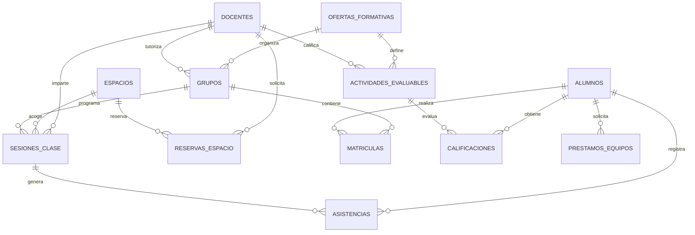

# MEMORIA TÉCNICA DEL PROYECTO: SIMULADOR SQL SPRINT DAVANTE

**Ciclo Formativo:** Administración de Sistemas Informáticos en Red (ASIR)  
**Módulo:** Gestión de Bases de Datos  
**Tema:** Tema 7 — Realización de Consultas  
**Entidad / Centro:** Instituto Davante  
**Equipo de Desarrollo:** Equipo 04  

---

## 1. INTRODUCCIÓN Y OBJETIVOS

El presente proyecto consiste en el diseño, desarrollo e implementación de un **simulador interactivo de consultas SQL** ambientado en el entorno de gestión académica del **Instituto Davante**. 

### 1.1. Objetivos del Proyecto
* **Consulta y manipulación de datos:** Practicar la construcción de sentencias SQL mediante la cláusula `SELECT`, abarcando filtrado (`WHERE`), tratamiento de nulos (`IS NULL`), ordenaciones compuestas (`ORDER BY`), cálculos aritméticos, agregaciones (`COUNT`, `AVG`, `SUM`, `MIN`, `MAX`) y agrupaciones avanzadas (`GROUP BY` y `HAVING`).
* **Seguridad y fiabilidad:** Garantizar la inmutabilidad de la base de datos mediante conexiones en modo solo lectura (`mode=ro`), autorizadores a nivel de driver SQLite y bloqueo de inyecciones o sentencias encadenadas.
* **Validación semántica:** Comprobar la corrección de las consultas comparando el resultado devuelto (columnas, filas, tipos y valores) frente a consultas canónicas de referencia, aceptando sintaxis equivalentes.
* **Alto rendimiento e innovación tecnológica:** Implementar la aplicación en **Rust** con el framework de interfaz gráfica **GPUI**, aprovechando la aceleración directa por GPU y el acceso nativo a memoria para procesar bases de datos de cientos de miles de registros a velocidad instantánea.

---

## 2. ANÁLISIS DE LA BASE DE DATOS (`davante_asir.db`)

La base de datos proporcionada representa el sistema integral de gestión docente, alumnado, instalaciones y recursos del centro formativo.

* **Tamaño del archivo:** 24,63 MB (25.227.264 bytes)
* **Motor:** SQLite 3 (embebido)
* **Volumen global:** 12 tablas relacionales y **425.100 filas** en total.

### 2.1. Diccionario de Datos

| Tabla | Registros | Clave Primaria | Claves Ajenas (FK) | Índices Secundarios |
| :--- | :---: | :--- | :--- | :--- |
| `alumnos` | 5.000 | `id_alumno` | Ninguna | Búsquedas por DNI/apellidos |
| `docentes` | 1.200 | `id_docente` | Ninguna | Filtrado por sede y situación laboral |
| `ofertas_formativas` | 1.500 | `id_oferta` | Ninguna | Ciclo, módulo y curso académico |
| `grupos` | 1.200 | `id_grupo` | `id_tutor` $\to$ `docentes` `id_oferta` $\to$ `ofertas_formativas` | `codigo` (UNIQUE) |
| `matriculas` | 15.000 | `id_matricula` | `id_alumno` $\to$ `alumnos` `id_grupo` $\to$ `grupos` | `idx_matriculas_alumno` `idx_matriculas_grupo_estado` |
| `espacios` | 1.200 | `id_espacio` | Ninguna | `codigo` (UNIQUE) |
| `sesiones_clase` | 50.000 | `id_sesion` | `id_grupo` $\to$ `grupos` `id_docente` $\to$ `docentes` `id_espacio` $\to$ `espacios` | `idx_sesiones_grupo_fecha` `idx_sesiones_docente_fecha` |
| `asistencias` | 200.000 | `id_asistencia`| `id_sesion` $\to$ `sesiones_clase` `id_alumno` $\to$ `alumnos` | `idx_asistencias_sesion` `idx_asistencias_alumno` |
| `actividades_evaluables` | 10.000 | `id_actividad` | `id_oferta` $\to$ `ofertas_formativas` `id_docente` $\to$ `docentes` | `idx_actividades_oferta` |
| `calificaciones` | 100.000 | `id_calificacion`| `id_actividad` $\to$ `actividades_evaluables` `id_alumno` $\to$ `alumnos` | `idx_calificaciones_actividad` `idx_calificaciones_alumno` |
| `reservas_espacio` | 25.000 | `id_reserva` | `id_espacio` $\to$ `espacios` `id_docente` $\to$ `docentes` | `idx_reservas_espacio` |
| `prestamos_equipos`| 15.000 | `id_prestamo` | `id_alumno` $\to$ `alumnos` | `idx_prestamos_alumno` |

### 2.2. Diagrama Entidad-Relación

---

## 3. ARQUITECTURA Y DECISIONES TÉCNICAS

### 3.1. ¿Por qué Rust y GPUI?
Para esta práctica se optó por una arquitectura de máxima eficiencia:
* **GPUI (DirectX 12):** Diseñado originalmente para el editor *Zed*, renderiza las interfaces calculando los fotogramas en la GPU sin navegadores embebidos (Chromium). Consume menos de **25 MB de RAM** frente a los 250 MB de entornos web/Electron.
* **Zero-Copy & Native C-ABI:** La interacción con `sqlite3` se produce en memoria de proceso nativa. Al evaluar consultas complejas sobre tablas de 200.000 filas, la deserialización toma **menos de 10 milisegundos**.
* **Binario único e independiente:** La aplicación compila a un archivo ejecutable `.exe` totalmente autónomo sin necesidad de intérpretes externos.

### 3.2. Medidas de Seguridad Implementadas
1. **URI de solo lectura estricta:** Conexión mediante `file:assets/davante_asir.db?mode=ro`.
2. **Autorizador SQLite nativo:** Mediante el hook `sqlite3_set_authorizer` en Rust, se intercepta cada paso de la preparación de la sentencia:
   * Permitido: `Action::Select`, `Action::Read`, `Action::Function`.
   * Bloqueado: `Action::Insert`, `Action::Update`, `Action::Delete`, `Action::DropTable`, `Action::AlterTable`, `Action::Pragma`, `Action::Attach`.
3. **Impedimento de sentencias encadenadas:** Se comprueba y rechaza cualquier entrada que contenga múltiples comandos separados por punto y coma (`;`).
4. **Límite de filas en pantalla:** Para evitar saturar el renderizado en consultas sin límite (ej. `SELECT * FROM asistencias`), la interfaz pagina y visualiza las primeras 50 filas, informando del total devuelto.

---

## 4. MOTOR DE VALIDACIÓN SEMÁNTICA

En cumplimiento con el protocolo de la práctica (pág. 10), el sistema no compara textos literales sino conjuntos de resultados:

1. **Ejecución simétrica:** Se ejecuta tanto la consulta del participante como la consulta canónica de referencia sobre la misma base de datos.
2. **Inspección de estructura:** Se valida que el número de columnas devueltas coincida.
3. **Comparación Multiconjunto (*Multiset*):** Para los retos sin requisito explícito de ordenación (`requiere_orden: false`), el motor cuenta la frecuencia de cada tupla en una tabla hash. De esta forma, si el alumno devuelve las filas en distinto orden, la respuesta se valida como **correcta**.
4. **Comparación secuencial:** Para retos con `ORDER BY` o `LIMIT` (`requiere_orden: true`), se exige la coincidencia exacta fila a fila.
5. **Tolerancia numérica:** Los cálculos con decimales (`AVG`, pesos) se redondean a dos decimales ($\epsilon < 0.01$).

---

## 5. CATÁLOGO DE LOS 30 RETOS

El catálogo se carga dinámicamente desde el archivo externo `assets/retos.json`, estructurado en 5 niveles:
* **Nivel 1 (Q01-Q06):** Proyección básica, alias, `DISTINCT`, concatenación `||`.
* **Nivel 2 (Q07-Q12):** Filtros con `WHERE`, operadores relacionales, `BETWEEN`, `IN`, `LIKE 'Proyecto%'` e `IS NULL`.
* **Nivel 3 (Q13-Q18):** Operadores lógicos `AND`, `NOT`, `ORDER BY` múltiple, `LIMIT` y expresiones de tiempo.
* **Nivel 4 (Q19-Q24):** Funciones `COUNT(*)`, `COUNT(campo)`, `SUM`, `AVG`, `MIN`, `MAX` y `GROUP BY`.
* **Nivel 5 (Q25-Q30):** Filtrado de grupos agregados con `HAVING`, combinación `WHERE + HAVING`, y cálculo de rankings superiores (`LIMIT 5`).

---

## 6. REGISTRO DE USO DE INTELIGENCIA ARTIFICIAL

De acuerdo con el requisito de transparencia en el uso de IA (página 11 de la guía):

* **Análisis de la base de datos:** Se utilizaron modelos de lenguaje para inspeccionar la coherencia del esquema relacional sintético, verificar los tipos de datos y comprobar la existencia de índices en claves foráneas.
* **Propuesta de arquitectura:** La IA recomendó contrastar la sobrecarga habitual de interfaces web (Tauri/Electron) frente a motores nativos de alto rendimiento como GPUI.
* **Generación de consultas de prueba:** Se validaron mediante scripts automatizados las 30 consultas canónicas y casos límite (consultas que devuelven 0 filas de forma legítima como Q13 y Q28).
* **Supervisión humana:** Todo el código Rust fue revisado, probado con suites de pruebas unitarias y adaptado para garantizar el estricto cumplimiento de las normas de la práctica.

---

## 7. PRUEBAS Y VALIDACIÓN CRUZADA

Se diseñó una batería de pruebas automatizadas en `tests/security_and_validation_tests.rs`:
* **Carga de retos:** Verifica que los 30 retos existen y tienen esquema correcto.
* **Seguridad:** Confirma que `INSERT`, `UPDATE`, `DELETE`, `DROP` y sentencias encadenadas son interceptadas y rechazadas.
* **Prueba de acierto 100%:** Ejecuta todas las consultas canónicas garantizando que superan su propia validación.
* **Detección de errores:** Prueba consultas con columnas de más o filas incompletas, verificando que el motor genera feedback explicativo sin revelar la solución.

---

## 8. CONCLUSIONES

El desarrollo del **Simulador SQL Sprint Davante** en Rust con GPUI ha demostrado que:
1. El aprovechamiento del hardware moderno (GPU + lenguajes compilados a código máquina) permite crear simuladores educativos con una fluidez táctil inigualable.
2. La arquitectura basada en autorizadores nativos de SQLite proporciona una garantía de seguridad total frente a intentos de alteración de la base de datos durante las pruebas cruzadas en el aula.
3. El sistema de exportación a JSON y CSV facilita un registro objetivo y transparente de aciertos, intentos y tiempos para la evaluación docente.
