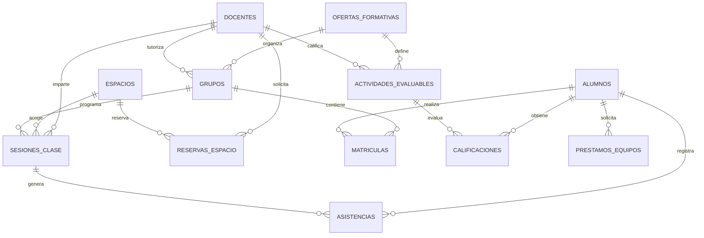

# MEMORIA TÉCNICA DEL PROYECTO: SIMULADOR SQL SPRINT DAVANTE

**Ciclo Formativo:** Administración de Sistemas Informáticos en Red (ASIR)  
**Módulo:** Gestión de Bases de Datos  
**Tema:** Tema 7 — Realización de Consultas  
**Entidad / Centro:** Instituto Davante  
**Alumno / Desarrollador:** Alumno ASIR  

---

## 1. INTRODUCCIÓN Y OBJETIVOS

El presente proyecto consiste en el diseño, desarrollo e implementación de un **simulador interactivo de consultas SQL** ambientado en el entorno de gestión académica del **Instituto Davante**. 

### 1.1. Objetivos del Proyecto
* **Consulta y manipulación de datos:** Practicar la construcción de sentencias SQL mediante la cláusula `SELECT`, abarcando filtrado (`WHERE`), tratamiento de nulos (`IS NULL`), ordenaciones compuestas (`ORDER BY`), cálculos aritméticos, agregaciones (`COUNT`, `AVG`, `SUM`, `MIN`, `MAX`) y agrupaciones avanzadas (`GROUP BY` y `HAVING`).
* **Seguridad y fiabilidad:** Garantizar la inmutabilidad de la base de datos mediante conexiones en modo solo lectura (`mode=ro`), autorizadores a nivel de driver SQLite y bloqueo de inyecciones o sentencias encadenadas.
* **Validación semántica:** Comprobar la corrección de las consultas comparando el resultado devuelto (columnas, filas, tipos y valores) frente a consultas canónicas de referencia, aceptando sintaxis equivalentes.
* **Puntuación por niveles y tiempo global:** Sistema de evaluación cronometrado a 5 minutos globales con progresión de puntos (10 a 50 pts por ejercicio) y un máximo de 900 puntos.
* **Alto rendimiento e innovación tecnológica:** Implementar la aplicación en **Rust** con el framework de interfaz gráfica **GPUI**, aprovechando la aceleración directa por GPU y el acceso nativo a memoria para procesar bases de datos de cientos de miles de registros a velocidad instantánea.

---

## 2. ANÁLISIS DE LA BASE DE DATOS (`davante_asir.db`)

La base de datos proporcionada representa el sistema integral de gestión docente, alumnado, instalaciones y recursos del centro formativo.

* **Tamaño del archivo:** 24,63 MB (25.227.264 bytes)
* **Motor:** SQLite 3 (embebido)
* **Volumen global:** 12 tablas relacionales y **425.100 filas** en total.

### 2.1. Diccionario de Datos

| Tabla | Registros | Clave Primaria | Claves Ajenas (FK) | Índices Secundarios |
| :--- | :---: | :--- | :--- | :--- |
| `alumnos` | 5.000 | `id_alumno` | Ninguna | Búsquedas por DNI/apellidos |
| `docentes` | 1.200 | `id_docente` | Ninguna | Filtrado por sede y situación laboral |
| `ofertas_formativas` | 1.500 | `id_oferta` | Ninguna | Ciclo, módulo y curso académico |
| `grupos` | 1.200 | `id_grupo` | `id_tutor` $\to$ `docentes` `id_oferta` $\to$ `ofertas_formativas` | `codigo` (UNIQUE) |
| `matriculas` | 15.000 | `id_matricula` | `id_alumno` $\to$ `alumnos` `id_grupo` $\to$ `grupos` | `idx_matriculas_alumno` `idx_matriculas_grupo_estado` |
| `espacios` | 1.200 | `id_espacio` | Ninguna | `codigo` (UNIQUE) |
| `sesiones_clase` | 50.000 | `id_sesion` | `id_grupo` $\to$ `grupos` `id_docente` $\to$ `docentes` `id_espacio` $\to$ `espacios` | `idx_sesiones_grupo_fecha` `idx_sesiones_docente_fecha` |
| `asistencias` | 200.000 | `id_asistencia`| `id_sesion` $\to$ `sesiones_clase` `id_alumno` $\to$ `alumnos` | `idx_asistencias_sesion` `idx_asistencias_alumno` |
| `actividades_evaluables` | 10.000 | `id_actividad` | `id_oferta` $\to$ `ofertas_formativas` `id_docente` $\to$ `docentes` | `idx_actividades_oferta` |
| `calificaciones` | 100.000 | `id_calificacion`| `id_actividad` $\to$ `actividades_evaluables` `id_alumno` $\to$ `alumnos` | `idx_calificaciones_actividad` `idx_calificaciones_alumno` |
| `reservas_espacio` | 25.000 | `id_reserva` | `id_espacio` $\to$ `espacios` `id_docente` $\to$ `docentes` | `idx_reservas_espacio` |
| `prestamos_equipos`| 15.000 | `id_prestamo` | `id_alumno` $\to$ `alumnos` | `idx_prestamos_alumno` |

### 2.2. Diagrama Entidad-Relación

---

## 3. ARQUITECTURA Y DECISIONES TÉCNICAS

### 3.1. ¿Por qué Rust y GPUI?
Para esta práctica se optó por una arquitectura de máxima eficiencia:
* **GPUI (DirectX 12):** Diseñado originalmente para el editor *Zed*, renderiza las interfaces calculando los fotogramas en la GPU sin navegadores embebidos (Chromium). Consume menos de **25 MB de RAM** frente a los 250 MB de entornos web/Electron.
* **Zero-Copy & Native C-ABI:** La interacción con `sqlite3` se produce en memoria de proceso nativa. Al evaluar consultas complejas sobre tablas de 200.000 filas, la deserialización toma **menos de 10 milisegundos**.
* **Identidad Visual Corporativa:** Integración del logotipo oficial del centro (`logotipo.png`) en el encabezado.
* **Binario único e independiente:** La aplicación compila a un archivo ejecutable `.exe` totalmente autónomo sin necesidad de intérpretes externos.

### 3.2. Medidas de Seguridad Implementadas
1. **URI de solo lectura estricta:** Conexión mediante `file:assets/davante_asir.db?mode=ro`.
2. **Autorizador SQLite nativo:** Mediante el hook `sqlite3_set_authorizer` en Rust, se intercepta cada paso de la preparación de la sentencia:
   * Permitido: `Action::Select`, `Action::Read`, `Action::Function`.
   * Bloqueado: `Action::Insert`, `Action::Update`, `Action::Delete`, `Action::DropTable`, `Action::AlterTable`, `Action::Pragma`, `Action::Attach`.
3. **Impedimento de sentencias encadenadas:** Se comprueba y rechaza cualquier entrada que contenga múltiples comandos separados por punto y coma (`;`).
4. **Límite de filas en pantalla:** Para evitar saturar el renderizado en consultas sin límite (ej. `SELECT * FROM asistencias`), la interfaz pagina y visualiza las primeras 50 filas, informando del total devuelto.

---

## 4. SISTEMA DE DIFICULTAD Y PUNTUACIÓN (900 PUNTOS)

| Nivel | Categoría Temática | Puntos / Reto | Total Nivel | Color Distintivo |
| :---: | :--- | :---: | :---: | :--- |
| **N1** | Selección y Proyección | 10 pts | 60 pts | Verde Esmeralda (`#10b981`) |
| **N2** | Filtrado con WHERE | 20 pts | 120 pts | Cian / Azul (`#06b6d4`) |
| **N3** | Ordenación y Límites | 30 pts | 180 pts | Violeta (`#8b5cf6`) |
| **N4** | Resumen y Agregación | 40 pts | 240 pts | Ámbar / Naranja (`#f59e0b`) |
| **N5** | Agrupación Avanzada (HAVING) | 50 pts | 300 pts | Rojo Coral (`#ef4444`) |
| **TOTAL** | **30 Retos Obligatorios** | - | **900 pts** | - |

---

## 5. TEMPORIZADOR GLOBAL Y EXPORTACIÓN FUNCIONAL

* **Temporizador Global Único (5 Minutos):** En lugar de otorgar 5 minutos por ejercicio, el participante dispone de **300 segundos globales** para resolver el máximo número de ejercicios posible, simulando un reto contrarreloj auténtico. Al agotarse el tiempo, la aplicación bloquea nuevas ejecuciones y abre automáticamente el informe de resultados.
* **Exportación en un Clic:** El botón de exportación genera de inmediato los archivos `exports/resultados_sprint_sql.json` y `exports/resultados_sprint_sql.csv`, presentando un diálogo con las rutas absolutas y un botón para abrir la carpeta directamente en el Explorador de archivos de Windows.
